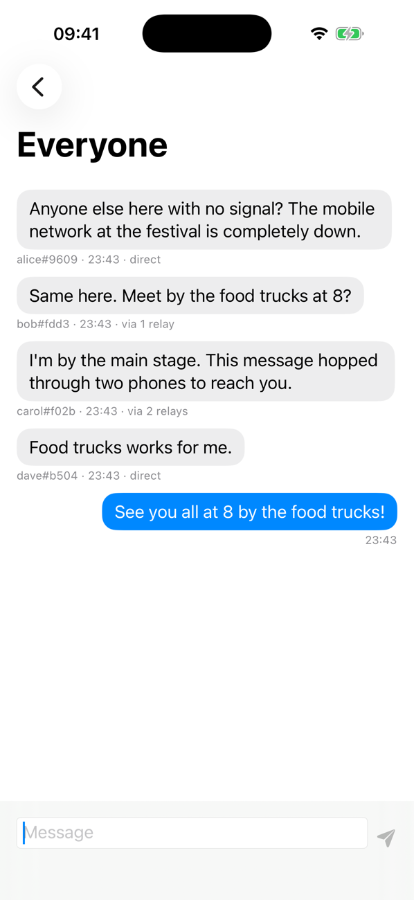
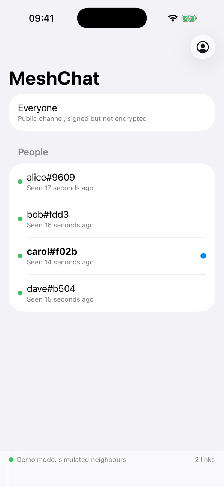
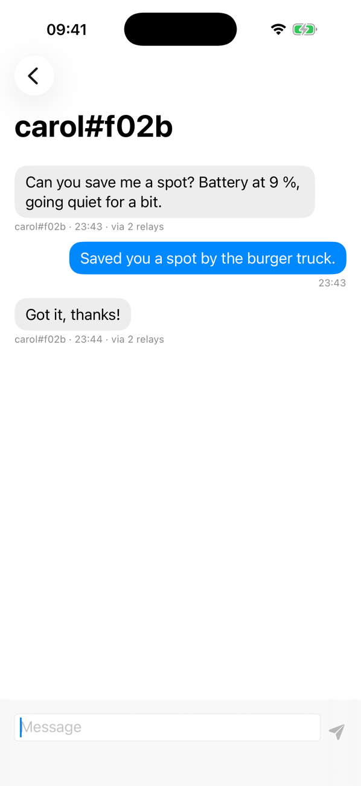

# MeshChat

Offline chat over a Bluetooth Low Energy mesh, for iPhone and Mac. No internet, no
servers, no accounts: every device carries messages for the others, so a message can
hop from phone to phone across a room, a building or a festival.

- **Public channel**: signed messages to everyone within 7 hops.
- **Direct messages**: end-to-end encrypted. The phones that relay them can't read them.
- **Store-and-forward**: devices carry recent messages and hand them to people they
  meet later, so the mesh doesn't need to be connected all at once.

<table>
  <tr>
    <td></td>
    <td></td>
    <td></td>
  </tr>
  <tr>
    <td align="center">Public channel: carol is two relays away</td>
    <td align="center">People nearby</td>
    <td align="center">Encrypted DM through two relays</td>
  </tr>
</table>

*Screenshots from [demo mode](#demo-mode): the real mesh code running over a simulated
network, because the iOS Simulator has no Bluetooth.*

## How it works

```
┌────────── App (SwiftUI, iOS + macOS) ──────────┐
│ ChatModel: conversations, peers, status         │
└──────────────────────┬──────────────────────────┘
                       │
┌────────── MeshCore (pure Swift, unit-tested) ───┐
│ MeshRouter   flooding + TTL, duplicate check,   │
│              signature check, store-and-forward │
│ Packet       compact binary format, Ed25519     │
│ DirectMessageCrypto  X25519 + HKDF + ChaChaPoly │
│ Fragmenter / Reassembler  BLE-sized frames      │
└──────────────────────┬──────────────────────────┘
                       │ MeshTransport protocol
          ┌────────────┴─────────────┐
┌─────────┴──────────┐   ┌───────────┴───────────┐
│ BLEMeshTransport   │   │ SimulatedNetwork      │
│ CoreBluetooth,     │   │ in-memory, for tests  │
│ central+peripheral │   │ and the meshsim tool  │
└────────────────────┘   └───────────────────────┘
```

**Discovery and links.** Every device advertises a custom GATT service and scans for
it at the same time. When two devices find each other, the one with the smaller
random node ID connects (so they don't open two links to each other), subscribes to
a single characteristic, and from then on frames go one way as
write-without-response and the other way as notifications.

**Routing.** Flooding with a hop limit, like bitchat. When a packet arrives:

1. Drop it if its ID was seen before (`SeenCache`).
2. Drop it if the signature is invalid, the hop limit is above 10, or it is too old.
   The signature is checked *before* the ID is marked as seen, so a forged copy
   arriving first can't block the real one.
3. Deliver it if it's public or addressed to us.
4. Unless it was a DM for us, decrement `ttl` and send it to every other link.
5. Keep a copy for store-and-forward.

**Packet format.** Binary, 127 bytes of overhead (header + 64-byte signature):

```
version | type | hopLimit | ttl | flags | id(16) | timestamp(8) | sender key(32)
| [recipient fingerprint(8)] | payload length(2) | payload | signature(64)
```

The signature covers everything except `ttl`, since relays have to change it.
`hopLimit` (the original TTL) is signed, so the UI can show "via 2 relays" and a relay
can't raise the limit.

**Encryption.** Direct messages use a fresh X25519 key per message, HKDF-SHA256 and
ChaCha20-Poly1305 (CryptoKit). The packet ID and sender key are bound in as
associated data, so nobody can re-sign someone else's ciphertext as their own.

**Fragmentation.** A BLE frame carries roughly 180 bytes (this depends on the
negotiated MTU), so larger packets are split into numbered fragments and put back
together per link.

## What the simulation shows

`meshsim` drops 40 nodes at random in a 100 × 100 m area, links nodes within 22 m of
each other (about BLE range indoors), loses 10 % of all frames, and sends one message
from a random node. The table averages 40 runs per TTL:

```
$ cd MeshKit && swift run -c release meshsim
TTL  reached (all)  reached (connected)  radio tx per message
  1          10.4%                13.0%                   4.7
  2          25.3%                31.8%                  27.3
  3          36.3%                45.6%                  51.0
  5          57.3%                72.0%                  85.4
  7          67.4%                84.7%                 108.0
```

"Connected" counts only the nodes that had any path to the sender. Takeaways:

- Most of the reach comes from the first few hops. Going from TTL 5 to 7 adds 13
  points of reach but costs 27 % more transmissions, and every transmission costs
  battery for whoever sends it.
- Flooding is wasteful: about 108 transmissions to reach about 26 nodes. A smarter
  relay rule (only relay if few neighbours have relayed already) would cut that.
- With 10 % frame loss, flooding still works because it sends over many paths at once.

Try other settings, for example `swift run -c release meshsim --nodes 80 --loss 0.3`.

## Running it

Requirements: Xcode 16 or newer (built with Xcode 26), iOS 17 or later, macOS 14 or later.

```bash
open MeshChat.xcodeproj
```

- **Mac**: pick the `MeshChat-macOS` scheme and run. The Mac is a full mesh node.
- **iPhone**: pick `MeshChat-iOS`, choose your phone, and set your team under
  *Signing & Capabilities* (a free Apple ID works). Change the bundle ID to
  something unique. With a free Apple ID, the app has to be reinstalled every 7 days.
- The iOS Simulator has no Bluetooth, so testing needs real devices.
- To test relaying (A → B → C), you need three devices, with A and C out of range of
  each other. A Mac, your phone and a borrowed phone are enough.

### Demo mode

Launch with the `-demo` argument (in Xcode: *Product → Scheme → Edit Scheme → Run →
Arguments*) to try the app without Bluetooth or a second device. The app's own
`MeshRouter` then runs over the in-memory `SimulatedNetwork` with four virtual
neighbours, laid out as `dave ── you ── alice ── bob ── carol`. They post a short
conversation, carol sends you an encrypted DM, and they reply to DMs you send. The
routing, signatures and encryption are the same code that runs over BLE; only the
radio is simulated.

### Tests and simulation

No devices needed:

```bash
cd MeshKit
swift test
swift run -c release meshsim
```

The Xcode project is generated from `project.yml` with
[XcodeGen](https://github.com/yonaskolb/XcodeGen). Run `xcodegen generate` after
adding or removing targets.

## Known limitations

- **iOS background**: when the app is in the background, iOS hides the advertised
  service in an "overflow area" and slows down scanning. Two backgrounded iPhones
  rarely find each other. The app works best in the foreground.
- **No forward secrecy for DMs**: anyone who steals a device's long-term key can read
  old DMs addressed to it. A Noise XX handshake per peer (as bitchat uses) would fix that.
- **Keys in UserDefaults**: fine for a demo, but they should live in the Keychain.
- **Flooding doesn't scale** to large, dense crowds (see the numbers above).
- **No Android** yet. The packet format is plain bytes, so a Kotlin port could join the
  same mesh using the same service and characteristic UUIDs.
- The BLE code builds and the mesh logic is tested, but behaviour across many
  physical devices has only been checked in simulation.

## Next steps

- Measure on real devices: delivery rate and latency per hop, and battery drain at
  different scan intervals.
- Probabilistic or counter-based relaying to cut transmissions.
- Delivery receipts for DMs.
- Message padding, so packet size doesn't reveal message length.
